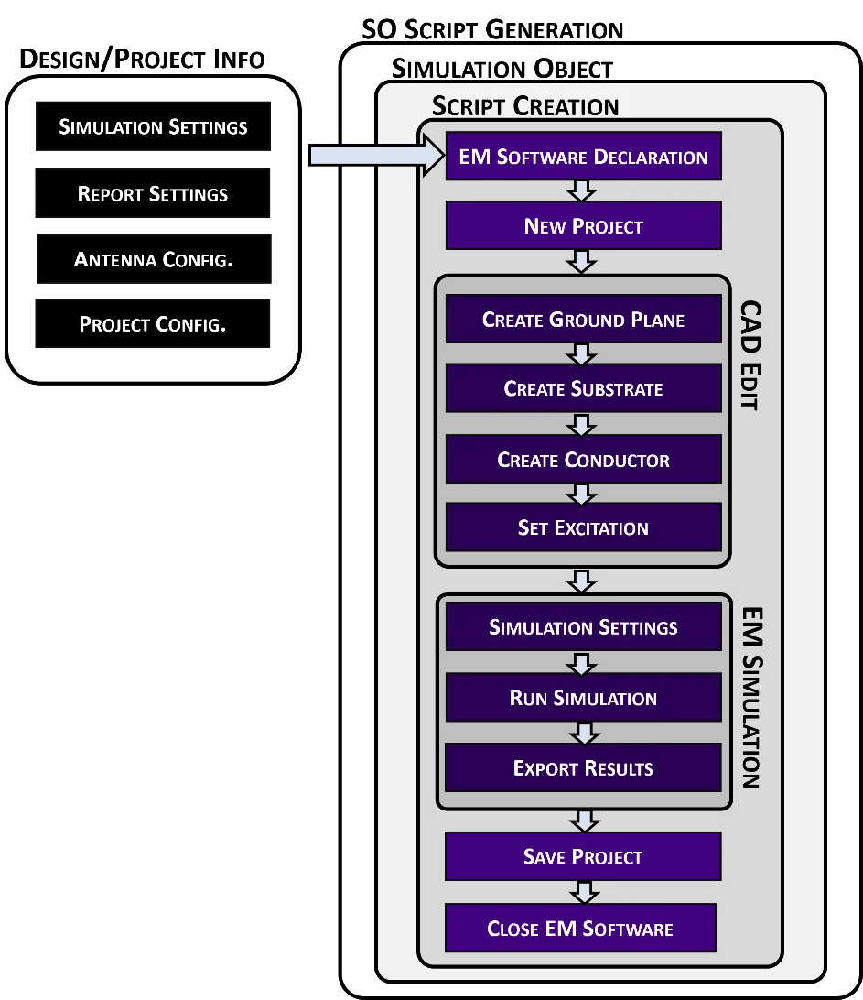

AntennaCAT is not a unified API for electromagnetic simulation software, and it was not planned to be one or replace one. Every commercial EM package (that we've used in research, at least) has its own scripting language, its own object model, and its own release schedule: Ansys HFSS records in IronPython, Altair FEKO speaks Lua, COMSOL wants Java, CST Studio Suite runs VBA macros. The approach for AntennaCAT was to make sure that experimental results were repeatable, accurate, and could be adjusted later as we checked our own results. 

To interface with the commercial EM software(s), it was decided that trying to write a Python wrapper around each of those, keeping the wrappers in sync with vendor updates (and the student vs. offical versions), and then teaching students to use four different wrappers was not a workable angle. So AntennaCAT controls the simulation software from the *outside*, using scripts the software already knows how to run.

This post is the high-level version of how that works. The next post gets into the template files themselves.

## Three parts

AntennaCAT is built in three pieces: the user interface, the kernel that handles optimization and data management, and the **Simulation Object** (SO), which is the only piece that knows anything about a specific EM package.

The "magic trick" is that the kernel only ever sees one kind of simulation software. When the kernel asks for a rectangular patch, it calls something like `create_rectangular_patch()` and gets a script back. It has no idea, and no reason to care, whether that script is IronPython for HFSS or Lua for FEKO. The Simulation Object is chosen once, when a project is created and an EM package is selected on the Settings page, and from then on every request from the kernel is routed through that SO to a matching **Simulation Integrator**, which assembles a script from a library of templates written in the target language.

That layering is what makes new software integrations possible without touching the rest of the program. If a package can be driven by a script, a Simulation Object can be written for it. Full integration exists for Ansys HFSS, which is where AntennaCAT was developed; the template process has been mapped and unit-tested for COMSOL, CST, EMPIRE, and FEKO.

## Closing the loop

Generating a script is half of the process. The other half is the loop that AntennaCAT runs during tuning, batch data collection, and optimization:

1. Fill in templates to produce a script: open or create a project, build the CAD, set up the simulation, export the reports.
2. Launch the EM software with that script using a plain system command. (This is done via terminal control)
3. The software runs, writes its reports to a local directory, saves the project, and closes.
4. AntennaCAT reads the exported results back in, analyzes them (resonant frequency, S11, gain, whatever the targets are), and hands the numbers to the optimizer.
5. The optimizer picks new parameter values, and AntennaCAT generates the *next* script: open the existing project, change the parameters, rerun, export.

Closing the software between iterations is deliberate. It means every iteration is a checkpoint; if a simulation fails, the project on disk is in a known state and the loop can recover rather than babysit a hung process.

Every simulation actually produces three scripts: the CAD creation script, the basic simulation script, and the combined script that AntennaCAT runs. The first two are self-contained and can be executed by a person, in the EM software, with no AntennaCAT involved. That was intentional. A student can take the script AntennaCAT wrote, read it, and recreate the design by hand, which is how a lot of people learn what the software is doing for them.

<figure>
  
  <figcaption>How a simulation script is assembled for the first iteration of tuning a patch antenna. On later iterations "New Project" becomes "Open Project" and the CAD block becomes a parameter edit. (NOTE: AI upconverted from a saved PNG for web viewing)</figcaption>
</figure>

## Why Do this?

Three reasons, in the order they mattered.

**Accessibility.** The barrier to entry for automated antenna design is not the math; it is getting the simulation software to do the same thing a thousand times without a person clicking. Scripting it is possible in every package, but each one is its own learning curve. AntennaCAT hides that behind one interface while still producing readable scripts.

**Adaptability.** When a vendor changes its scripting conventions, the fix is a text file in the template library, not a rewrite. Adding a new antenna topology is a new set of templates and a generator function. Adding a new EM package is a new Simulation Object.

**Experimentation.** Because everything runs from parameterized scripts, a design can be varied endlessly, in a repeatable environment, with every variation and its results recorded. That is what the batch data collection and the optimizer suite are built on, and it is where the machine learning work in the later papers came from.

## Where to read more

The [AntennaCAT wiki](https://github.com/LC-Linkous/AntennaCalculationAutotuningTool/wiki) is the maintained documentation. The architecture is written up formally in the [IEEE Antennas and Propagation Magazine article](https://doi.org/10.1109/MAP.2025.3560851) and in chapter 2 of my [dissertation](https://scholarscompass.vcu.edu/etd/7841/). The next post, [AntennaCAT Modular Template Building Blocks](/posts/antennacat-template-building-blocks/), opens up the template library.

*This post was written alongside the dissertation and held until the related publications were out; it was released publicly the first time in August 2025.*

