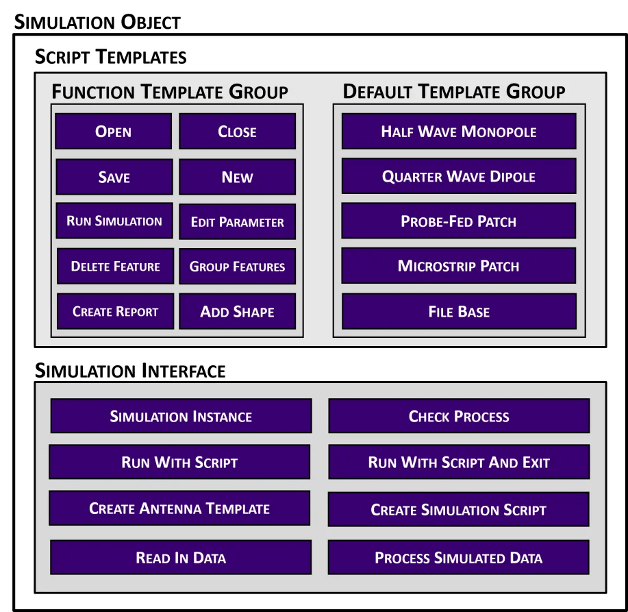

<div class="justified-content" markdown="1">

The [previous post](/posts/antennacat-modular-api/) described AntennaCAT's Simulation Object as the one piece of the program that knows how to talk to a particular EM package. This post is about what is inside it: a library of small text files, each one a complete action in the simulation software's own scripting language, with placeholders where the numbers go. AntennaCAT builds scripts by picking the right files, filling in the placeholders, and stacking them in order. Like Legos. But digital.

## What a template looks like

Every integrated EM package has its own template library. For Ansys HFSS, the files live under `simulation_integrator/ANSYS/code_templates/` and are grouped by what they do: `open-file`, `parameter`, `design-change`, `simulation`, `solution-type`, `report-templates`, and the complete `calculator-designs` and `replication-designs`. They are IronPython, because that is what HFSS records and runs, but to AntennaCAT they are just text.

Here is the whole of `open-file/open-existing-project-base.txt`:

```python
import ScriptEnv
ScriptEnv.Initialize("Ansoft.ElectronicsDesktop")
oDesktop.RestoreWindow()
oDesktop.OpenProject(r"INSERT_PROJECT_PATH")
oProject = oDesktop.SetActiveProject("INSERT_PROJECT_NAME")
oDesign = oProject.SetActiveDesign("HFSSDesign1")
oEditor = oDesign.SetActiveEditor("3D Modeler")
```

One job, two placeholders, and seven total lines of code. This is what makes the modularity possible, and often times AntennaCAT design has chosen modularity over simplicity. Every placeholder in every template is designed to be a human-readable `INSERT_SOMETHING`.  When a script is generated, the Simulation Integrator loads the file and swaps each one out using a regular expression. There is no parser and no abstract syntax tree; it is string replacement on files that were already valid scripts before the placeholders went in.

A slightly bigger block, `parameter/parameter-edit-single.txt`, changes one project variable:

```python
oProject.ChangeProperty(
    [
        "NAME:AllTabs",
        [
            "NAME:ProjectVariableTab",
            ["NAME:PropServers", "ProjectVariables"],
            [
                "NAME:ChangedProps",
                ["NAME: INSERT_PARAM_NAME ", "Value:=", "INSERT_PARAM_VALUE"]
            ]
        ]
    ])
```

And `design-change/shape_add_rectangle.txt` draws a rectangle whose width and height are not numbers at all but references to project variables, `$particle_x` and `$particle_y`, with only its position, name, and material left as placeholders. 

## Parameters, not numbers

EM simulation software already supports parameterized designs: you can define a project variable like `$seed_width = 20mm` and build geometry from it. Changing the variable moves the geometry. AntennaCAT relies on that principle to operate. The templates that create CAD declare dimensions, gaps, and feed positions as project variables, then draw with the variable names.

The payoff comes on the second iteration. The first time a design is simulated, the generated script has to do everything: declare the software, make a new project, build the ground plane, substrate, conductor, and excitation, configure the solution, run it, export reports, save, close. The second time, when the optimizer has decided to make the patch 0.3 mm wider, the script is much shorter: open the project, change `$patch_width`, rerun, export. No CAD is rebuilt from scratch. For a complex design that is the difference between a tuning loop that takes an afternoon vs. one that takes days, and it's a feature that most EM sim software supports (and already use in their own optimization methods!). 

It also means templates written against variables are reusable across designs. The rectangle template does not know or care whether it is drawing a patch, a ground plane, or a seed element in a genetic-algorithm grid; it draws a rectangle sized by two variables that something else has already defined.

<figure>
  
  <figcaption>Example groupings in the Simulation Object. Function templates are single actions that chain; default templates are complete designs with placeholders. (NOTE: image is AI upconverted from a saved PNG for web viewing)</figcaption>
</figure>

## Two kinds of block (to keep it simple)

The library has two kinds of file, and the distinction matters on the development end.

**Function templates** are single actions: open, save, close, add a shape, set a parameter, add a report trace. None of them is a runnable script on its own, but each is a *complete* action that does not depend on what ran before it. That independence is a rule, not an accident. Templates are reduced to the fewest steps that still fully accomplish one thing, so that any sequence of them can be concatenated without one block undoing or assuming another.

**Default templates** are the complete designs: the calculated topologies (rectangular patch, half-wave dipole, quarter-wave monopole) and the replication-study topologies (E-shaped patches, serpentine dual-band, coplanar keyhole, loops, bowties). Each is a full, self-contained script with placeholders; fill them in and it runs in the EM software with no further assembly. These are what the Antenna Generator tab produces when a user picks a topology and types in a target frequency and substrate.

The Simulation Integrator mostly works by taking a default template for the CAD and then chaining function templates around it for the simulation setup, reports, and housekeeping. Each generator function in `templateGen_Design.py` (`patchStripFedScriptGenerator`, `dualBandSerpentineScriptGenerator`, and so on) is the recipe for one topology: which files, which placeholders, which order.

## Designing templates for how antennas are built

The modularity comes from designing the templates around how an antenna is constructed geometrically and procedurally, not around how a person uses the software. A human designing a patch in a GUI draws something, adjusts it, undoes, redraws, renames, and moves on. A script recorded from that session is full of commands that only make sense in sequence (and this is how I started with the development, and its what we learned from). AntennaCAT's templates instead ask: what is the minimal set of steps that creates a substrate? A conductor? An excitation? Each answer becomes a file, and because each file does exactly one thing from scratch, they do not conflict when stacked.

This is also what makes the library maintainable. When a vendor changes how a command is spelled (applied, or otherwise used), one text file changes. When a new topology is needed, it is a new default template and a generator function. When a whole new EM package is added, it is a new folder of templates in a new language and a Simulation Object that knows the folder; the function names the kernel calls stay the same.

## Trying it yourself

The templates are plain text in the [AntennaCAT repository](https://github.com/LC-Linkous/AntennaCalculationAutotuningTool), so the easiest way to understand the system is to open a few and read them next to the generated script in an AntennaCAT project folder. The [wiki](https://github.com/LC-Linkous/AntennaCalculationAutotuningTool/wiki) covers the user-facing side; the formal description of the template approach is section 2.2 and 2.4 of my [dissertation](https://scholarscompass.vcu.edu/etd/7841/).

*This post was written alongside the dissertation and held until the related publications were out; it was first released publicly in August 2025.*

</div>
