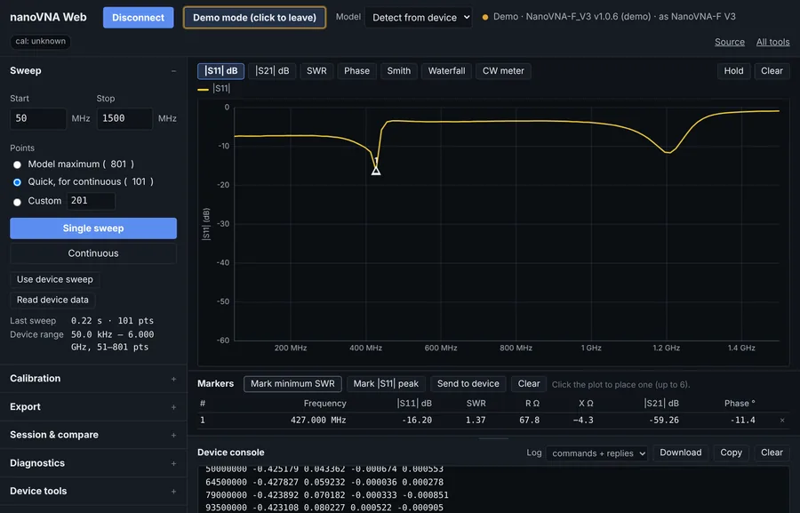
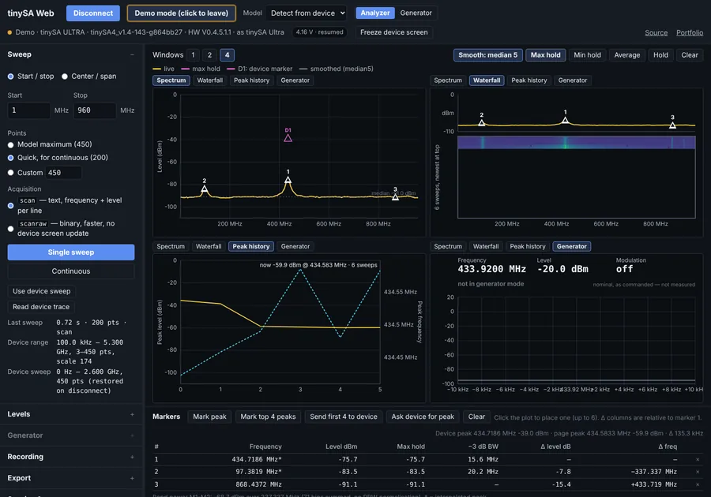
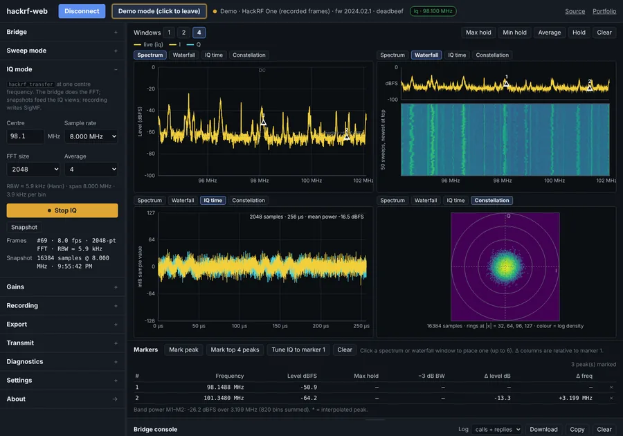

<div class="justified-content" markdown="1">

There are three pieces of RF test equipment I cycle through for projects: a NanoVNA-F for antenna measurements, a tinySA Ultra for looking at spectrum emissions, and a HackRF One for anything that needs a software-defined radio. To streamline my process, I've spent a lot of time creating Python libraries and plug-and-play device control to make sure my equipment is as portable as possible. There were other references out there that did about half of what I needed, but no singular source that did enough for me to modify.

Each of the three tools here has something cool: a documented way to drive the device and collect data via script. The last two years have yielded three Python libraries, and this year that turned into three browser pages that use the same protocols. This post is a tour of the pages, written for someone who has one of these devices and wants to know what the tools do before opening them.

The short version: each tool is a static web page. Open it in Chrome or Edge, plug the device in over USB, click connect, and work. Nothing to install for the two serial devices. Every page has a **Try without hardware** button that runs it against a simulated instrument, so you can look around and click things without getting the hardware out.

## The pairing

| Device | Measures | Python library | Browser tool |
| --- | --- | --- | --- |
| NanoVNA-F V2 / V3 | S-parameters: reflection, transmission, impedance | [nanoVNA_python](https://github.com/LC-Linkous/nanoVNA_python) (`nvnapython`) | [nanoVNA Web](https://lc-linkous.github.io/nanovna-web/) |
| tinySA, tinySA Ultra | Spectrum: power against frequency | [tinySA_python](https://github.com/LC-Linkous/tinySA_python) (`tsapython`) | [tinySA Web](https://lc-linkous.github.io/tinysa-web/) |
| HackRF One | IQ samples: anything, if you do the math | [hackRF_python](https://github.com/LC-Linkous/hackRF_python) (`hackrfpy`) | [hackrf-web](https://lc-linkous.github.io/hackrf-web/) |

The library and the page for each device speak the same protocol and use the same method names, so reading one is reading the other. These are different tools for different problems. The libraries were designed for repeatable scripts of common functions: batch sweeps, test fixtures, anything that wants numpy, and for plotting live(ish) data on a larger screen. The web browser page is for the bench and for demos. This allows users to watch the trace, trim the antenna, sweep continuously, record data, and try things live on a larger screen. Importantly, the web browser controls the device in real time, so users who have trouble navigating the touch screens now have another option.

For research and testing, files can also move between the library and web browser. These are based on CSV, Touchstone, and JSON, so a measurement can start in the browser and finish in a notebook, or a file the library produced can be loaded under the live trace as an overlay. Only one of the two can hold the serial port at a time, but that's generally been a good trade-off for the workability.

## nanoVNA Web

<figure>
  
</figure>

A front end for the NanoVNA-F V2 and F V3. It shows |S<sub>11</sub>| and |S<sub>21</sub>| in dB, SWR, phase, a Smith chart, and a rolling waterfall of the magnitude history, with markers reading frequency, SWR, and R + jX at each point. SOLT calibration is step-through and runs *on the device*: the page sends the commands and shows what it last sent, so the result is the device's own calibration, exactly as if you had stepped through it on the touchscreen. Electrical delay is the same.

The feature I use most is the least impressive one: a **CW meter** that reads out a single frequency as one large number, for trimming an antenna while you watch SWR fall. The exports are CSV, Touchstone `.s1p` and `.s2p` for anything downstream (a simulator, a matching-network tool, nanoVNA_python), and PNGs of the plots. It will also pull a screenshot of the instrument's own screen over the same cable, which is handy for recording data.

## tinySA Web

<figure>
  
</figure>

A front end for the tinySA and tinySA Ultra. Live spectrum in dBm, a waterfall, and a peak-history view, across one, two, or four windows at once. Max hold, min hold, power averaging, and display smoothing are done *on the page*, not on the device. This means that the recorded data stays raw, and the smoothing is a view you can turn off; so it can be pretty while you demo, but the real data isn't lost. Markers interpolate the peak frequency between bins and report −3 dB bandwidth and band power. The device-side settings (RBW, attenuation, LNA, spur removal) are set on the device through the page.

Both acquisition paths are there: `scan`, which returns text, and `scanraw`, which returns binary at roughly three times the speed. A diagnostic runs the two over the same range and reports the offset between them. If you read the [tinySA examples post](/posts/tinysa-five-examples/), that is the scan-versus-scanraw overlay from example 3, automated; a constant offset means the scale factor is wrong for your firmware build. Generator mode puts the device into output for a commanded tone.

## hackrf-web

<figure>
  
</figure>

This one is different, because the HackRF is not related to the other two devices in terms of firmware or construction. The other two devices present a text console over USB serial, which a browser can talk to directly through the Web Serial API. The HackRF does not; it streams raw IQ samples over USB and expects host software to do everything. So hackrf-web has a small Python bridge that runs on the machine the board is plugged into:

```
pip install hackrf-web
hackrf-web          # starts the bridge, prints a token, opens the page
```

The page talks to the bridge over a WebSocket, which also means it works in Firefox, not just Chrome and Edge. What you get is a swept spectrum and waterfall across any span up to 6 GHz, IQ capture at one center frequency with the FFT computed off the browser, time-domain and constellation views of IQ snapshots, and IQ recording to SigMF.

Two things that were design choices. Levels are in **dBFS, not dBm**: the HackRF is not a calibrated instrument, and rather than assume a conversion, the unit is carried through everywhere. And **transmit is locked** unless the bridge is started with `--allow-tx`, and then it is time-capped and confirmed. The demo mode needs no bridge at all; it replays frames computed from a real recording of the FM band, which is why the screenshot above has real stations in it.

## Try without hardware

Every page has a simulated device or a short loop of recorded data, rather than a screenshot standing in for the visuals. The simulator answers the same commands with the same bytes a real instrument would: a simulated F V3 for nanoVNA Web, a simulated Ultra for tinySA Web, replayed real frames for hackrf-web. That is what makes the tools usable for teaching and demos when there is one instrument or limited space, and it is also how most of the automated tests run; the page is exercised against the simulator, and the real hardware is checked less often, by hand, on the bench.

## What is tested, and how to help

I only own some of the hardware covered by each of the projects: nanoVNA Web is tested on an F V2 and F V3, with the H4 and generic profiles selectable but broadly untested; tinySA Web is tested on an Ultra (ZS405), with the Basic and Ultra+ selectable but untested; hackrf-web is tested on a HackRF One. Each page has a **Diagnostics** section that runs a fixed set of commands, records the raw replies and their timings, and downloads a JSON file to attach to a GitHub issue. If you have a device I do not, that file is how these pages get validated against it.

The three tools, the two fox-hunting tools, and the teaching instruments are all on the [Tools](/tools/) page, with changelogs linked from each. The libraries are on [Projects](/projects/#python-device-libraries).

</div>