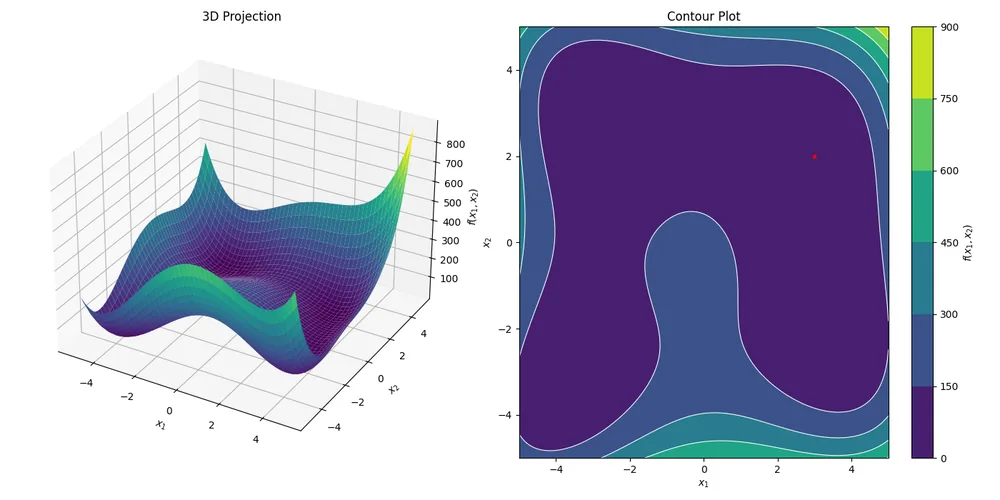

<div class="justified-content" markdown="1">

AntennaCAT's optimizer tab is backed by a collection of standalone Python optimizers, each in its own repository, but all of them share a standardized structure to make them swappable (modular) in the AntennaCAT software. 

This short post is the casual overview I'd been meaning to share now that the optimizer set is staying stable and not getting too many updates. This covers the broad talking points of the collection: what is in it, why the optimizers are built the way they are, and how the objective function suite fits in. The collection has been growing since 2023, and this is where it stands as of late 2026.

## What is in the collection

The optimizers are commonly dropped in a grid when I link them. This is to connect the variations in implementation. Typically, a base implementation, an alternate variant where the literature has a well-known one, and a quantum-inspired version if it was applicable.

|  | Base | Alternate | Quantum-inspired |
| --- | --- | --- | --- |
| Particle swarm | [pso_python](https://github.com/LC-Linkous/pso_python) | [pso_basic](https://github.com/LC-Linkous/pso_python/tree/pso_basic) | [pso_quantum](https://github.com/LC-Linkous/pso_quantum) |
| Cat swarm | [cat_swarm_python](https://github.com/LC-Linkous/cat_swarm_python) | [sand_cat](https://github.com/LC-Linkous/cat_swarm_python/tree/sand_cat_python) | [cat_swarm_quantum](https://github.com/LC-Linkous/cat_swarm_python/tree/cat_swarm_quantum) |
| Chicken swarm | [chicken_swarm_python](https://github.com/LC-Linkous/chicken_swarm_python) | [2015](https://github.com/LC-Linkous/chicken_swarm_python/tree/improved_chicken_swarm) / [2022 improved](https://github.com/LC-Linkous/chicken_swarm_python/tree/2022_improved_chicken_swarm) | [chicken_swarm_quantum](https://github.com/LC-Linkous/chicken_swarm_python/tree/chicken_swarm_quantum) |
| MultiGLODS | [multi_glods_python](https://github.com/LC-Linkous/multi_glods_python) | [GLODS](https://github.com/LC-Linkous/GLODS_python) / [DIRECT](https://github.com/LC-Linkous/DIRECT_python) | — |
| Genetic / evolutionary | [ga_python](https://github.com/LC-Linkous/ga_python) | [de_python](https://github.com/LC-Linkous/de_python) | [qea_python](https://github.com/LC-Linkous/qea_python) |
| Other | [sweep_python](https://github.com/LC-Linkous/sweep_python), [bayesian_optimization_python](https://github.com/LC-Linkous/bayesian_optimization_python) | sweep alternates in the base repo | — |

Some of these are serious tools. Some of them (the quantum chicken swarm, for one) are in the collection because a paper existed, and seemed to be a good counterpart to some of our 'default' optimizers. That turned out to be the reason of making a real collection: when every optimizer is a drop-in for every other, "how does it behave" becomes an experiment we could run quickly instead of it being a full reimplementation of the project.

Two repositories use the optimizer set. [surrogate_model_optimization](https://github.com/LC-Linkous/surrogate_model_optimization) wraps most of the collection in one surrogate-assisted framework, where an approximator stands in for the expensive objective function between real evaluations; the approximators (RBF network, Gaussian process, Kriging, polynomial regression, etc.) are also interchangeable, and they grew out of the Bayesian optimizer's internals. And the [objective_function_suite](https://github.com/LC-Linkous/objective_function_suite) is the benchmark set, which gets its own section below.

<figure>
  
  <figcaption>Himmelblau's function from the benchmark suite, rendered by the plotting shared across the collection. Four equal minima make it a quick check that an optimizer is not just finding the nearest one.</figcaption>
</figure>

## Why every optimizer is a state machine

The root of the optimizer set is the state machine. It is the core design feature that lets the optimizers run with AntennaCAT: every optimizer is a state machine driven from the outside by a controller loop, and every version exposes the same three calls.

The usual way to write an optimizer is with an objective function call: hand it an objective (an equation), it runs to convergence, and then it returns an answer. That is fine until the objective function is an EM simulation that takes multiple minutes to hours. The EM simulations also are controlled by another process and can fail. This is when you want the optimizer to *stop* (not transistion to the next state) between evaluations. 

To do this, each optimizer is written as a state machine that advances one step at a time, and the loop that drives it lives in driver:

```python
while not optimizer.complete():
    optimizer.step(suppress_output)          # move the particles / agents
    optimizer.call_objective(allow_update)   # evaluate, if the caller allows it
    iteration, best = optimizer.get_convergence_data()
```

- **`complete()`** reports whether a stop condition has been met: a maximum number of iterations, or convergence to the target within an L2-norm tolerance. Iterations are counted as calls to the objective function, not loop passes, so the count stays accurate to the part of the process that has the most cost (simulation time).
- **`step()`** advances the algorithm by one update: new positions, new velocities, whatever the method does. It does not evaluate anything, just 'moves' one part of the machine (or one agent in a swarm).
- **`call_objective()`** performs the evaluation, and only if the caller says so. In a plain benchmark run `allow_update` is always true. Inside AntennaCAT it is the hook that lets the kernel decide when a simulation is allowed to start, pause the whole process without losing state, or draw in a result that came from somewhere else.
- **`get_convergence_data()`** is a peek at the current iteration count and best evaluation, for logging or a live plot, without touching the optimizer's state.

The state machine form preserves the published algorithm, which is important when the whole point is comparing optimizers fairly, while making the objective function a thing passed *in* rather than a thing the optimizer owns. The same optimizer will run with any of the demo functions or the EM simulation without needing to change the driving loop.

A few other things are shared across the collection because of this structure. The optimizer state can be exported at any step and reimported later, which is how long runs survive a crashed simulation. Bounds handling is configurable (random respawn, reflection, absorb, or invisible walls). Constraints beyond the bounds are a user-supplied function passed into the constructor. And evaluation can be against an exact target or a threshold (less-than, greater-than) per output, which is what an antenna problem usually needs: S<sub>11</sub> *below* −10 dB, gain *above* 5 dBi, resonance *at* 2.45 GHz.

## The objective function suite

To compare optimizers you need problems with known answers. The [objective_function_suite](https://github.com/LC-Linkous/objective_function_suite) is the set used to collect performance data across the collection. 60+ functions are pulled from popular literature, where each is in its own directory with the same three-file layout the optimizers expect (`func_F.py` for the function, `constr_F.py` for constraints, `configs_F.py` for bounds, dimensions, targets, and the known global minimum), plus plots of the surface, the documented decision and objective spaces, and the literature citations for each one

The functions are grouped as single-input single-objective, single-objective, multi-objective (with Pareto fronts), and constrained functions. There is also an **AntennaCAT set** of functions that do not come from any paper. Those were written to fill specific gaps: input/output combinations like three inputs and five outputs that the classic benchmarks do not cover but that antenna problems produce constantly. They are stress tests, not literature.

The three-file layout for configuring an objective function is a standard template, so it doubles as a collection examples of how to implement custom objective functions.

## Using it

Each repository has a runnable example and a README that follows the same outline (initialization, the state machine loop, state import and export, constraint handling, boundary types, objective function handling), so once you have read one you can find your way around the others. Start with [pso_python](https://github.com/LC-Linkous/pso_python); it is the most-used and the most-documented. If your problem is computationally expensive to evaluate, start with [surrogate_model_optimization](https://github.com/LC-Linkous/surrogate_model_optimization) instead.


</div>
