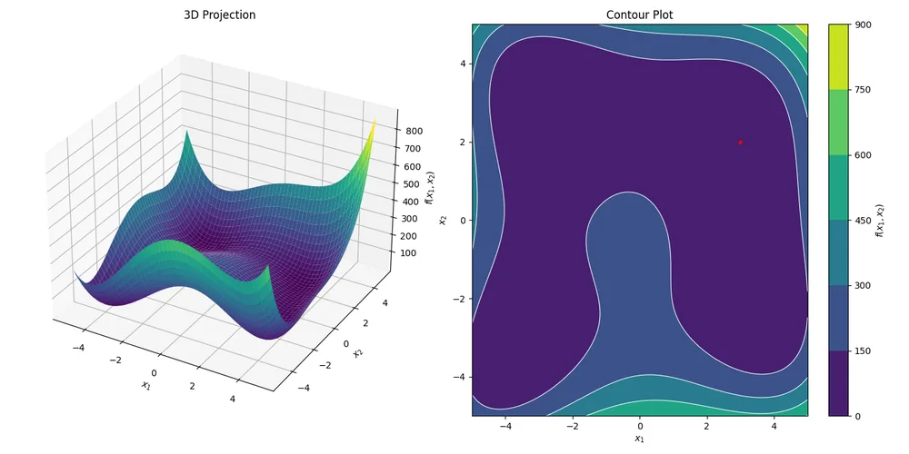
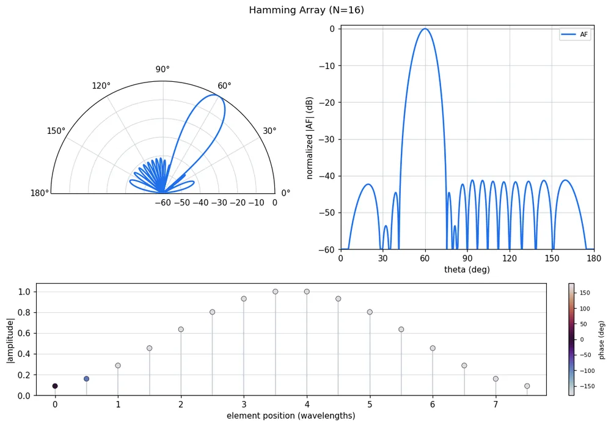
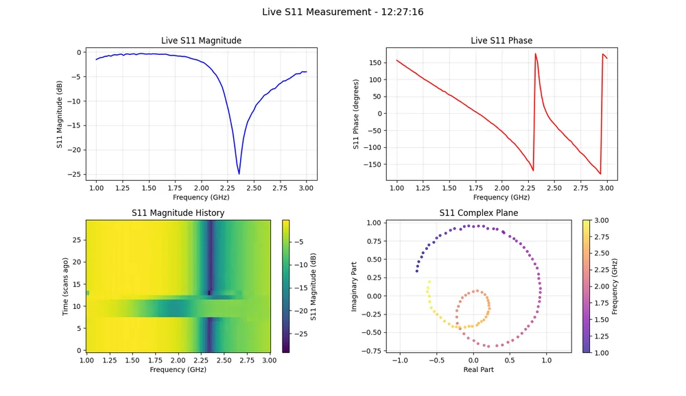
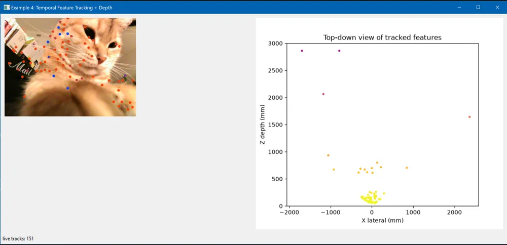
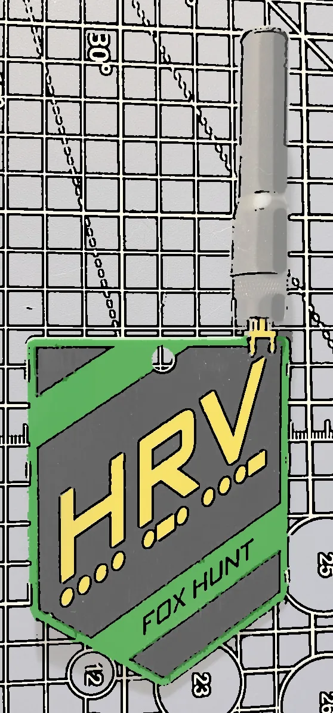
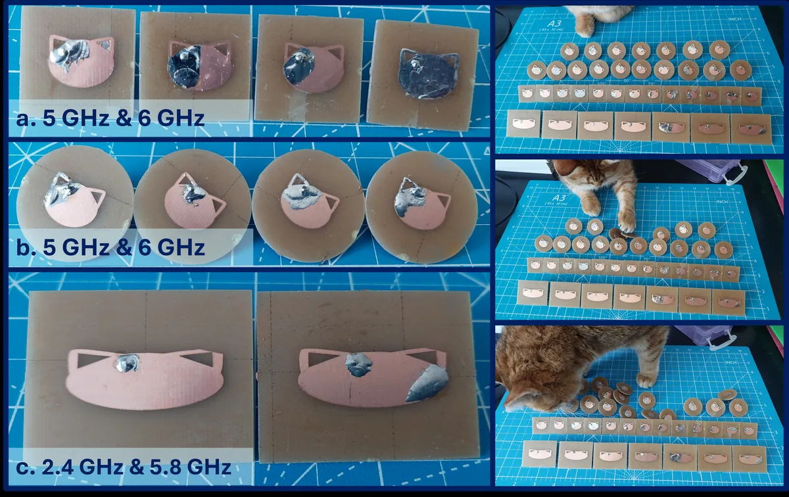
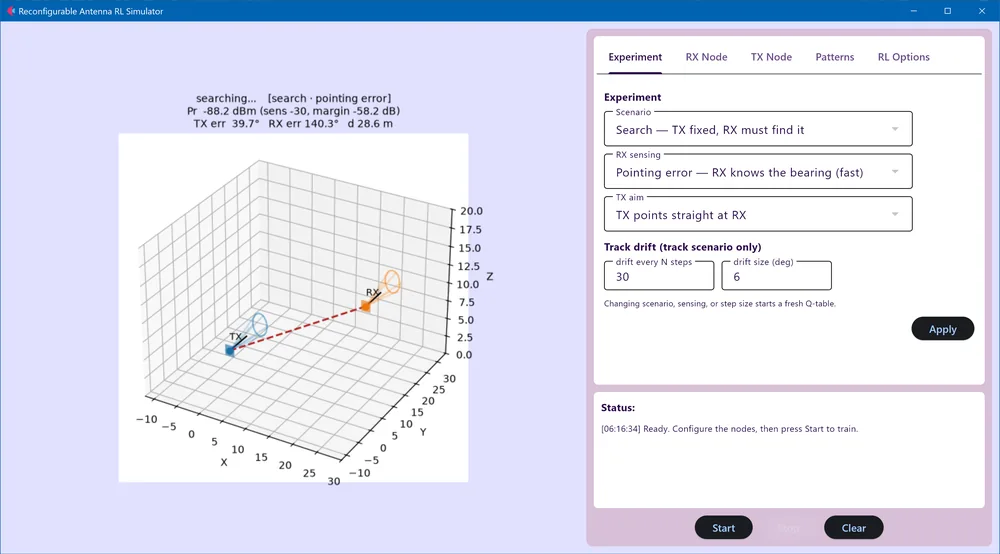

Research software, optimizers, Python libraries, firmware, course material,
hardware, teaching demos, and community projects. The browser instruments have their own page: [Tools](/tools/).

---

## AntennaCAT

### Antenna Calculation and Autotuning Tool

[Source](https://github.com/LC-Linkous/AntennaCalculationAutotuningTool) ·
[Wiki](https://github.com/LC-Linkous/AntennaCalculationAutotuningTool/wiki) ·
[Release schedule](https://github.com/LC-Linkous/AntennaCalculationAutotuningTool/blob/main/README.md#release-schedule)

AntennaCAT applies machine learning to automate, evaluate, and optimize the
antenna design process against EM simulation software. A combined antenna
designer and internal calculator accelerates CAD construction and simulation of
several common topologies while eliminating model disparity, so data collection
can run automatically rather than being rebuilt by hand for each design.

Published in *IEEE Antennas and Propagation Magazine* (2025) and presented at
USNC-URSI NRSM and IEEE AP-S; see [Publications](/publications). Less formal
notes on design and planning are under the [#antennacat](/tags/antennacat/)
tag.

**Status:** the 2025 release is the current full release. The optimizers are
being reworked for numpy 2.x, which is the current priority; the wiki carries
feature documentation and how-to guides, and the release schedule in the README
has the near-term plan.

---

## Optimization

A collection of state-machine-based optimizers that integrate with AntennaCAT,
plus the benchmarking and evaluation tools around them. Some of these are
serious; some of them are not.

<figure>
  
  <figcaption>Himmelblau's function as rendered by the optimizer collection's shared plotting; the same figure heads the pso_python and surrogate_model_optimization READMEs.</figcaption>
</figure>

|  | PSO | Cat Swarm | Chicken Swarm | MultiGLODS | Genetic | Other |
| --- | --- | --- | --- | --- | --- | --- |
| **Base** | [pso_python](https://github.com/LC-Linkous/pso_python) | [cat_swarm](https://github.com/LC-Linkous/cat_swarm_python) | [chicken_swarm](https://github.com/LC-Linkous/chicken_swarm_python) | [multi_glods](https://github.com/LC-Linkous/multi_glods_python) | [ga_python](https://github.com/LC-Linkous/ga_python) | [sweep](https://github.com/LC-Linkous/sweep_python), [bayesian](https://github.com/LC-Linkous/bayesian_optimization_python) |
| **Alternate** | [pso_basic](https://github.com/LC-Linkous/pso_python/tree/pso_basic) | [sand_cat](https://github.com/LC-Linkous/cat_swarm_python/tree/sand_cat_python) | [2015](https://github.com/LC-Linkous/chicken_swarm_python/tree/improved_chicken_swarm) / [2022 improved](https://github.com/LC-Linkous/chicken_swarm_python/tree/2022_improved_chicken_swarm) | [GLODS](https://github.com/LC-Linkous/GLODS_python) / [DIRECT](https://github.com/LC-Linkous/DIRECT_python) | [de_python](https://github.com/LC-Linkous/de_python) | sweep alternates in base repo |
| **Quantum-inspired** | [pso_quantum](https://github.com/LC-Linkous/pso_quantum) | [cat_swarm_quantum](https://github.com/LC-Linkous/cat_swarm_python/tree/cat_swarm_quantum) | [chicken_swarm_quantum](https://github.com/LC-Linkous/chicken_swarm_python/tree/chicken_swarm_quantum) | — | — | [qea_python](https://github.com/LC-Linkous/qea_python) |

**[Surrogate Model Optimization](https://github.com/LC-Linkous/surrogate_model_optimization)**
unifies most of the collection into one surrogate-assisted framework with
interchangeable approximators.

**[Objective Function Library and Test Suite](https://github.com/LC-Linkous/objective_function_suite)**
is the benchmarking side: 60+ objective functions from the literature with
documented solution, decision, and objective spaces, including Pareto fronts.
Citations are in the README.

**[ArrayCalculator](https://github.com/LC-Linkous/ArrayCalculator)** is a
command-line calculator, synthesizer, and evaluator for linear antenna arrays,
built to be called as the evaluation step inside an optimizer loop and
compatible with AntennaCAT.

<figure>
  
  <figcaption>ArrayCalculator: a 16-element Hamming-weighted array steered off boresight, with the element weights below.</figcaption>
</figure>

---

## Python device libraries

Non-GUI Python APIs for RF test hardware. Each has a browser counterpart on the
[Tools](/tools/) page that speaks the same device protocol, so files (`.csv`,
`.s1p` / `.s2p`, `.json`) move between the two. Unofficial, and not endorsed by
any of the device manufacturers.

| Device | Repository | PyPI | Browser tool |
| --- | --- | --- | --- |
| tinySA, tinySA Ultra | [tinySA_python](https://github.com/LC-Linkous/tinySA_python) | [`tsapython`](https://pypi.org/project/tsapython/) | [tinySA Web](/tools/#tinysa-web) |
| NanoVNA-F V2 / V3 | [nanoVNA_python](https://github.com/LC-Linkous/nanoVNA_python) | [`nvnapython`](https://pypi.org/project/nvnapython/) | [nanoVNA Web](/tools/#nanovna-web) |
| HackRF One | [hackRF_python](https://github.com/LC-Linkous/hackRF_python) | [`hackrfpy`](https://pypi.org/project/hackrfpy/) | [hackrf-web](/tools/#hackrf-web) |

`tsapython` is archived with a DOI and is citable:
[doi:10.5281/zenodo.20546764](https://doi.org/10.5281/zenodo.20546764).

<figure>
  
  <figcaption>A live S11 measurement scripted with nanoVNA_python: magnitude, phase, waterfall, and complex plane, the same views the browser tool shows.</figcaption>
</figure>

**[sdr_dsp_python](https://github.com/LC-Linkous/sdr_dsp_python)** is a DSP
library in progress, developed alongside the device libraries for processing
collected data.

---

## Embedded and firmware

Firmware and board support that grew out of the fox-hunt work and the teaching
demos, mostly on Seeed XIAO ESP32 boards.

**[foxlib and foxlib-c](https://github.com/LC-Linkous/fox-bench)** are the two
firmware libraries behind [fox-bench](/tools/#fox-bench): `foxlib` in
CircuitPython for boards driving a NiceRF SA868, and `foxlib-c` in C, shipped as
a UF2. Both are written against the same `PROTOCOL.md` contract as the page and
its simulated board, so a fox configured in the browser behaves the same
whichever firmware it runs. Supported
targets are the DC34 fox (XIAO ESP32-C3 + SA868), the AI6YM PicoFox, network
foxes on XIAO C3/C6/C5/S3, Waveshare ESP32-S3-Nano, FireBeetle 2 ESP32-C5, and
Arduino Nano 33 BLE, and rfhs kitsune boards; the network and kitsune targets
are experimental. A headless batch flasher writes a fleet of boards from one
CSV.

**[fox-hunt-web firmware](https://github.com/LC-Linkous/fox-hunt-web)** is the
receive-side CircuitPython for the same XIAO + SA868 board, with transmit
disabled by default and keying guarded by a stored callsign, a per-session arm,
and a hardware deadline on every key-down.

**[interactive-hardware-interfacing](https://github.com/interactive-hardware-interfacing)**
demo firmware: CircuitPython for six ESP-NOW demos on the XIAO ESP32-C3, plus
Arduino and CircuitPython builds for the LED I–V lab on an Adafruit ItsyBitsy
M4, each written against a documented serial protocol and flashed from the
browser. The demos themselves are under [Demos and interactive labs](#demos-and-interactive-labs).

---

## Teaching material

The public half of units built for undergraduate electives. The full versions
include slides, additional examples, and group assignments. Teaching approach
and outcomes from this material are written up in ASEE papers; see
[Publications](/publications).

**[Cryptography and encryption](https://github.com/LC-Linkous/cryptography_examples)** —
basic encryption methods, their decryption, and an overview of cryptography,
with demos and references for further reading.

**[Reverse engineering](https://github.com/LC-Linkous/reverse_engineering_notes)** —
methodology and tool selection for getting started, with extensive references.
Educational use only; examples focus on tool usage.

**[Machine learning for antenna data](https://github.com/LC-Linkous/2024-URSI-NRSM-1265)** —
a five-part series on analyzing data from antenna design simulation, with a
~30k-point multi-dimensional sample included.

**[Computer vision](https://github.com/LC-Linkous/computer_vision_notes)** —
processing live video for point tracking and depth estimation with a dual-lens
USB camera.

**[Kalman filtering](https://github.com/LC-Linkous/kalman_filter)** — an
interactive demo in which balls bounce under gravity while a noisy sensor
reports position only; one Kalman filter per ball estimates position and
velocity, with live NEES/NIS consistency metrics that show the moment the
filter's model is wrong. A wxPython GUI for experimenting and a headless Monte
Carlo script for a formal consistency study.

**[Simulated medical device data](https://github.com/LC-Linkous/data_interfacing_demo)** —
three clinical waveforms (ECG, SpO₂, invasive blood pressure) streamed as binary
packets over a mock serial transport, mirroring a bedside monitor's pipeline, so
students can practice parsing, filtering, and feature extraction on live data
with no hardware.

<figure>
  
  <figcaption>From the computer vision samples: feature tracking on a live feed, with the top-down view of the tracked points.</figcaption>
</figure>

---

## Demos and interactive labs

[interactive-hardware-interfacing](https://interactive-hardware-interfacing.github.io/) ·
[Source](https://github.com/interactive-hardware-interfacing)

A collection of browser-based teaching material for undergraduate electronics
and wireless courses, kept in its own GitHub organization so each piece can be
pulled into a course on its own. Everything runs as a static page in Chrome or
Edge, carries a `PROTOCOL.md` that the page, the simulated hardware, and the
firmware are written against, and has a demo mode so it can be used without
the hardware on the desk.

**Interactive labs**

- **[LED I–V Lab](https://interactive-hardware-interfacing.github.io/led-iv-lab/)**
  ([source](https://github.com/interactive-hardware-interfacing/led-iv-lab)) —
  a browser instrument for a diode I–V lab: pick one of four LEDs, sweep the
  drive voltage, and plot forward voltage and current live from an Adafruit
  ItsyBitsy M4. Arduino firmware built to `.uf2` by CI, with a CircuitPython
  build as a swap-in; exports CSV for the lab report.
- **[Intro EMF Lab](https://interactive-hardware-interfacing.github.io/intro-EMF-lab/)**
  ([source](https://github.com/interactive-hardware-interfacing/intro-emf-lab)) —
  browser field simulators for an introductory electromagnetism course: point
  and line charges in 2D and 3D, Gauss's law, capacitors, conduction, dielectric
  interfaces, magnetic fields, inductors, transmission lines, an FDTD tab, and
  a free sandbox, each with its equations alongside. A relaxation solver runs
  off the main thread, every tab's state lives in the URL so a configuration
  can be shared as a link, and closed-form benchmarks gate each deploy. No
  hardware involved; this one is all simulation.

**Wireless demos** — six short demos on Seeed XIAO ESP32-C3 boards using
ESP-NOW, each isolating one idea. The page flashes the CircuitPython firmware
and then shows what is happening over the air.

| Demo | What it shows | Boards |
| --- | --- | --- |
| [morse-key-demo](https://interactive-hardware-interfacing.github.io/morse-key-demo/) | Signaling and encoding; a keyboard mode needs no hardware at all | 1–2 |
| [packet-inspector-demo](https://interactive-hardware-interfacing.github.io/packet-inspector-demo/) | What is inside a packet: a 32-byte frame, CRC, loss | 2 |
| [wireless-address-demo](https://interactive-hardware-interfacing.github.io/wireless-address-demo/) | Unicast vs. broadcast, with acknowledgements | 4 |
| [telemetry-demo](https://interactive-hardware-interfacing.github.io/telemetry-demo/) | Sensor data over the air (HC-SR04 range finder) | 2 |
| [rssi-demo](https://interactive-hardware-interfacing.github.io/rssi-demo/) | Signal strength against distance and transmit power | 2 |
| [espsdr-demo](https://interactive-hardware-interfacing.github.io/espsdr-demo/) | The 2.4 GHz band as an SDR: spectrum, waterfall, I/Q, using ESPARGOS ESP-SDR firmware on the receiver | 1–2 |

The firmware side of these is under [Embedded and firmware](#embedded-and-firmware);
the two labs also appear with the other browser instruments on
[Tools](/tools/#teaching-instruments).

---

## Amateur radio hardware

**[DC34 fox transmitter](https://github.com/HamRadioVillage/dc34fox)** —
updated the design and fabricated the transmitter hardware used in the Ham
Radio Village Fox Hunt at DEF CON 34, and served as contest lead for the event.
The fox is a small beacon built around a Seeed XIAO ESP32-C3 and a NiceRF
SA868, running single-file CircuitPython firmware that transmits a Morse ID and
a short song on a loop for direction-finding practice. The repository includes
flashing, configuration, and legal-operation documentation written for
first-time hardware users.

**[Fox hunt write-ups](https://github.com/HamRadioVillage/fox-hunt-writeups/tree/main/dc34)** —
post-contest write-ups covering how the hunt was structured and run.

<figure style="max-width:360px">
  
  <figcaption>The DC34 fox board with its Ham Radio Village Fox Hunt shield. Image from the HamRadioVillage/dc34fox repository.</figcaption>
</figure>

The browser tooling for these, [fox-bench](/tools/#fox-bench) for building
transmitters and [fox-hunt-web](/tools/#fox-hunt-web) for finding them, is on
the Tools page.

---

## Little Ram Pantries

[littlerampantries.com](https://littlerampantries.com/) ·
[Papers and coverage](/publications)

A network of sixteen free miniature food pantries across VCU's two campuses,
launched in 2021 as a decentralized complement to the main Ram Pantry. Each
pantry is instrumented: a door sensor logs use, an inward-facing camera
photographs the shelves (never people) so students can check what is stocked
before walking over, and a status indicator shows whether the unit is online. I
built the initial prototype and have mentored the College of Engineering
capstone teams that developed the current hardware. The program's design and
outcomes are written up in two *JAFSCD* papers, and news coverage is collected
on the Publications page.

---

## Research antennas

<figure>
  
  <figcaption>Cat-shaped WiFi antennas for 5 and 6 GHz and for 2.4 and 5.8 GHz, with Sybil, the inspiration for the design, inspecting the samples.</figcaption>
</figure>
**[Research Antenna Collection](https://github.com/LC-Linkous/research_antenna_collection)** —
measurements and `.dxf` files for antenna samples that have appeared in papers,
including the
[cat antenna collection](https://github.com/LC-Linkous/research_antenna_collection#cat-antennas),
which has turned up in publications, projects, and conferences. See also the
[Cat Antennas](/tags/antennas/) posts.

---

## Code from papers

<figure>
  
  <figcaption>The experiment GUI from the 2025 reinforcement-learning reconfigurable antenna work.</figcaption>
</figure>
**2025** —
[Reinforcement Learning Controlled Mechanically Reconfigurable Antennas](https://github.com/LC-Linkous/2025_URSI_RL_Reconfigurable_Antennas),
USNC-URSI NRSM 2025, Boulder, paper #1237. Code and demo from the paper; the
equipment used has since had official hardware and firmware updates, so a
rework against the current versions is pending.

**2024** —
[Machine Learning Assisted Hyperparameter Tuning for Optimization](https://github.com/LC-Linkous/2024-APS-URSI-3323),
IEEE AP-S 2024, Florence. Data and select machine learning examples.

**2024** —
[Machine Learning Assisted Optimization Methods for Automated Antenna Design](https://github.com/LC-Linkous/2024-URSI-NRSM-1265),
USNC-URSI NRSM 2024, Boulder. Data and examples; also the basis of the
machine-learning tutorial series under Teaching material.

---

## Collaborations

**[AntennaCalculator](https://github.com/Dollarhyde/AntennaCalculator)** —
Dollarhyde's CLI tool for basic antenna design. The
[fork](https://github.com/LC-Linkous/AntennaCalculator) adds a GUI alongside
the CLI.
