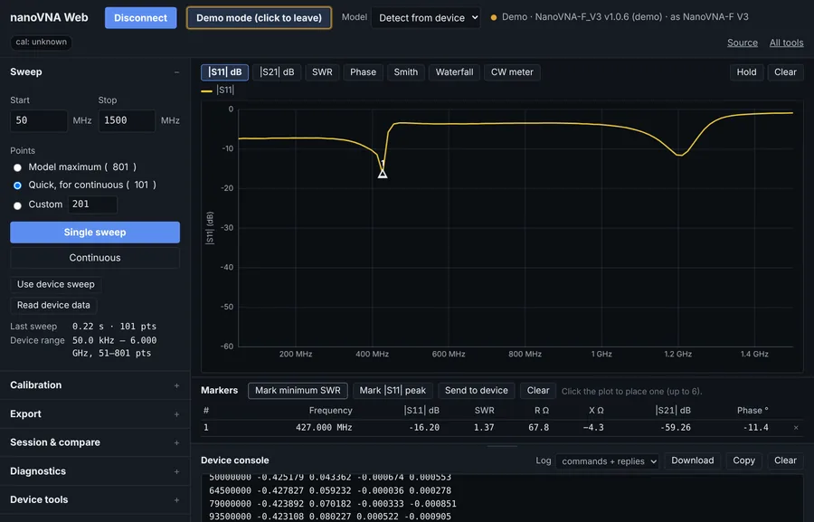
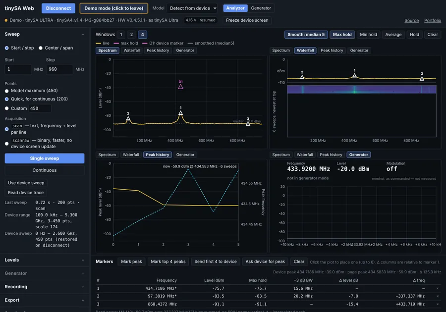
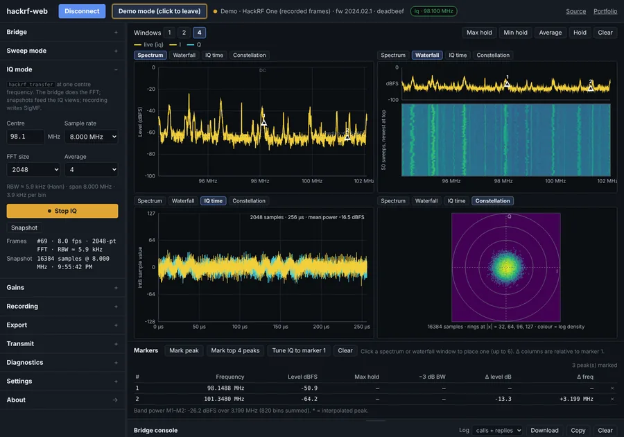
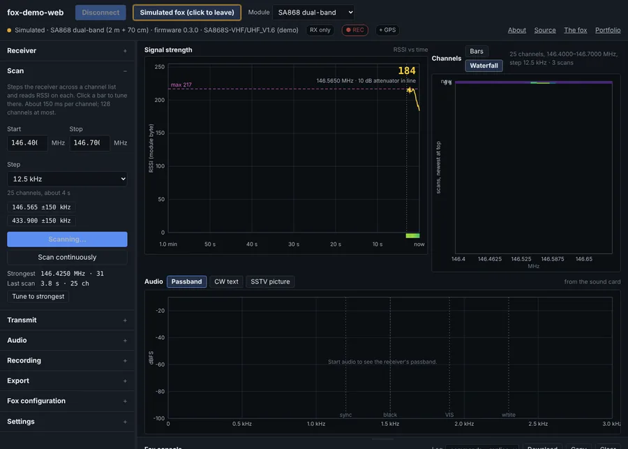
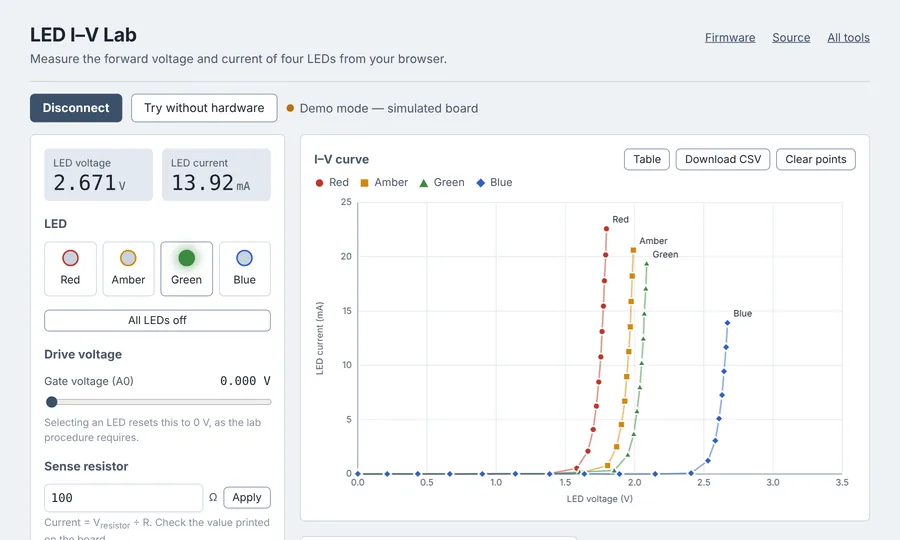

Browser-based instruments for RF work and for teaching. Each one is a static
page: open it in Chrome or Edge, connect the hardware over USB, and work.
Nothing to install for the serial devices, and every page has a **Try without
hardware** button that runs it against a simulated device, so the whole set can
be used, and taught with, whether or not the instrument is on the desk.

Each tool is its own repository with its own device layer. What they share is a
convention: a `PROTOCOL.md` that the page, the simulated device, and (where
there is one) the firmware are all written against. Where a tool has a Python
library for the same hardware, the two mirror each other so a measurement can
start in the browser and finish in a script. The Python libraries, the
command-line tools, and the firmware are listed on [Projects](/projects/).

Source is on [GitHub](https://github.com/LC-Linkous) under the GPL; licenses
are in each repository.

---

## Measurement

### nanoVNA Web

[Open](https://lc-linkous.github.io/nanovna-web/) ·
[Source](https://github.com/LC-Linkous/nanovna-web) ·
[Changelog](https://github.com/LC-Linkous/nanovna-web/blob/main/CHANGELOG.md)

<figure class="half">
  
</figure>

A front end for the NanoVNA-F V2 and F V3. |S11| and |S21| in dB, SWR,
phase, a Smith chart, and a rolling waterfall, with markers reading frequency,
SWR, and R + jX. Step-through SOLT calibration and electrical delay run on the
device; the page sends the commands and shows what it last sent. A CW meter
gives a single-frequency readout for trimming an antenna while watching one
number. Exports CSV, Touchstone `.s1p` / `.s2p`, and plot PNGs, and pulls a
screenshot of the instrument's own screen over the same cable.

*Tested on:* NanoVNA-F V3. *Selectable but untested:* NanoVNA-H4 and the
generic profile. Devices that speak the V2/SAA-2 binary protocol will not work.
Companion to [nanoVNA_python](https://github.com/LC-Linkous/nanoVNA_python).

### tinySA Web

[Open](https://lc-linkous.github.io/tinysa-web/) ·
[Source](https://github.com/LC-Linkous/tinysa-web) ·
[Changelog](https://github.com/LC-Linkous/tinysa-web/blob/main/CHANGELOG.md)

<figure class="half">
  
</figure>

A front end for the tinySA and tinySA Ultra. Live spectrum in dBm, waterfall,
and peak history across one, two, or four windows, with max hold, min hold,
power averaging, and display smoothing done on the page so the recorded data
stays raw. Markers interpolate the peak frequency between bins and report −3 dB
bandwidth and band power. RBW, attenuation, LNA, and spur removal are set on
the device. Both acquisition paths are available, `scan` for text and `scanraw`
for binary at roughly three times the speed, and a diagnostic runs the two over
the same range and reports the offset between them. Generator mode puts the
device into output mode for a commanded tone.

*Tested on:* tinySA Ultra (ZS405). *Selectable but untested:* tinySA Basic
(ZS304) and Ultra+ (ZS406/ZS407). Needs device firmware v1.4-182 or later.
Companion to [tinySA_python](https://github.com/LC-Linkous/tinySA_python).

### hackrf-web

[Open](https://lc-linkous.github.io/hackrf-web/) ·
[Source](https://github.com/LC-Linkous/hackrf-web) ·
[Protocol](https://lc-linkous.github.io/hackrf-web/protocol/) ·
[Changelog](https://github.com/LC-Linkous/hackrf-web/blob/main/CHANGELOG.md)

<figure class="half">
  
</figure>

A bench page for the HackRF One. Swept spectrum and waterfall across any span to
6 GHz, IQ at one center frequency with the FFT computed off the browser, IQ
snapshots as time-domain and constellation views, and IQ recording to SigMF.

The HackRF is not a serial device, so unlike the two tools above this one needs
a small Python bridge on the machine the board is plugged into:

```
pip install hackrf-web
hackrf-web          # starts the bridge, prints a token, opens the page
```

Levels are dBFS, not dBm: the HackRF is not a calibrated instrument, and the
unit is carried on the axis, the markers, and every export rather than quietly
assumed. Transmit is locked unless the bridge is started with `--allow-tx`, and
then it is time-capped and confirmed. Demo mode needs no bridge; it replays
frames computed from a real recording of the FM band. Because the page talks to
the bridge over a WebSocket rather than Web Serial, it also runs in Firefox.
Companion to [hackRF_python](https://github.com/LC-Linkous/hackRF_python).

---

## Fox hunting

Two tools for the same hobby from opposite ends: one builds and configures fox
transmitters, the other finds them in the field. Both target the hardware used
in the [Ham Radio Village Fox Hunt](https://github.com/HamRadioVillage/dc34fox).

### fox-bench

[Open](https://lc-linkous.github.io/fox-bench/) ·
[Source](https://github.com/LC-Linkous/fox-bench) ·
[Changelog](https://github.com/LC-Linkous/fox-bench/blob/main/CHANGELOG.md)

A workbench for building fox transmitters. Configure a fox in a form, hear and
see what it will transmit before it goes on the air (Morse ID, song, SSTV
picture, QRSS trace), then write the firmware and settings over USB, bench-test
it, and keep a log of the fleet. A headless batch flasher takes the same CSV as
the Fleet tab for building more than one at a time.

It supports CircuitPython boards driving a NiceRF SA868 (the DC34 fox), the
AI6YM PicoFox, and network foxes on several ESP32 and Arduino boards. The
firmware behind it, `foxlib` (CircuitPython) and `foxlib-c` (C, shipped as
UF2), is described on [Projects](/projects/#embedded-and-firmware).

*On the air:* all FM templates on a XIAO ESP32-C3 + SA868 on 2 m and 70 cm;
PicoFox; `foxlib-c` on a rev 3 board. *Experimental:* the network-fox templates
have not been run on real boards.

### fox-hunt-web

[Open](https://lc-linkous.github.io/fox-hunt-web/) ·
[Source](https://github.com/LC-Linkous/fox-hunt-web) ·
[Changelog](https://github.com/LC-Linkous/fox-hunt-web/blob/main/CHANGELOG.md)

<figure class="half">
  
</figure>

A receiver and direction-finding instrument for the DC34 fox, a Seeed XIAO
ESP32-C3 driving a NiceRF SA868. Tune 2 m or 70 cm, watch signal strength live,
scan a channel list for the one with a fox on it, decode a fox's Morse ID and
SSTV pictures from the audio, and log it all to CSV.

Beyond the signal meter, it does the things a hunter actually wants: an
autoseek that steps a channel list and stops where a signal rises above that
channel's own learned noise floor; cycle timing that watches threshold crossings
to work out how long the fox keys and how often, then counts down to the next
burst; and a bearing capture, where you hold a button, turn through a circle
with a directional antenna, and get a lobe center on a polar chart, with two
captures from different places giving a fix. A hunt mode collapses everything
into one phone-width column for walking with a yagi, the page installs the
fox firmware over CircuitPython's REPL, and a service worker keeps it working
offline after one visit. The audio decoders (CW, carrier-keyed Morse, and
SSTV in Martin, Scottie, and Robot36) run on any receiver through a USB sound
card, so a handheld tuned to the fox gets you the ID and the pictures with
nothing soldered.

Transmit ships off: the firmware is receive-only by default, and enabling it
puts keying behind a stored callsign, a per-session arm, and a hardware deadline
on every key-down. A license is needed to transmit; none is needed to receive.

*Status:* written and tested against the simulated fox and synthesized audio.
Not yet run against a real fox; the in-page installer is unproven on hardware.
Runs on Android Chrome over USB-OTG. iOS has no Web Serial, so iPhones get the
audio decoders, the simulated fox, and session replay.

---

## Teaching instruments

The [interactive-hardware-interfacing](https://interactive-hardware-interfacing.github.io/)
collection holds lab instruments and demos built for undergraduate electronics
and wireless courses. Same rules as the tools above: Chrome or Edge, a
`PROTOCOL.md` in every repository, a demo mode on every page.

### LED I–V Lab

[Open](https://interactive-hardware-interfacing.github.io/led-iv-lab/) ·
[Source](https://github.com/interactive-hardware-interfacing/led-iv-lab)

<figure class="half">
  
</figure>

A browser instrument for an electronics lab on diode I–V curves. Students pick
one of four LEDs, sweep the drive voltage, and watch forward voltage and
current plot live from an Adafruit ItsyBitsy M4 over USB. Results export as CSV
for the lab report. The repository carries the whole experiment: a documented
serial protocol, Arduino firmware built to a `.uf2` by CI and attached to each
release, and a CircuitPython build speaking the same protocol as a swap-in
option. Every LED switch is driven off and the DAC set to zero on power-up, on
disconnect, and at the end of every sweep.

### Intro EMF Lab

[Open](https://interactive-hardware-interfacing.github.io/intro-emf-lab/) ·
[Source](https://github.com/interactive-hardware-interfacing/intro-emf-lab)

Browser-based field simulators for an introductory electromagnetism course,
in one static page with a tab per topic: point and line charges in 2D and 3D,
Gauss's law, capacitors, conduction, dielectric interfaces, magnetic fields,
inductors, transmission lines, FDTD, and a sandbox, each with its governing
equations shown beside the plot. The relaxation solver runs in a web worker so
the page stays responsive, the full state of every tab is encoded in the URL so
a configuration can be handed to students as a link, and a set of closed-form
benchmarks runs before each deploy. No hardware; this one works in any modern
browser.

The six **ESP-NOW wireless demos** from the same collection are listed under
[Demos and interactive labs](/projects/#demos-and-interactive-labs) on the
Projects page.

---

## Found a device that misbehaves?

The three measurement tools have a **Diagnostics** section that runs a fixed
set of commands, records the raw replies and their timings, and downloads a
JSON file to attach to a GitHub issue. That is how these pages get validated
against hardware they have not seen; the "untested" models above are the ones
where such a report is most useful. fox-hunt-web's console log download does
the same job, and its audio decoders were written against synthesized signals,
so a recorded WAV of a real fox attached to an issue becomes a test.

Chrome or Edge is required for the direct-USB tools; they are the browsers that
implement [Web Serial](https://developer.mozilla.org/en-US/docs/Web/API/Web_Serial_API).
Firefox and Safari can run the demo modes, and Firefox can run hackrf-web
through its bridge.
